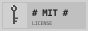
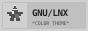
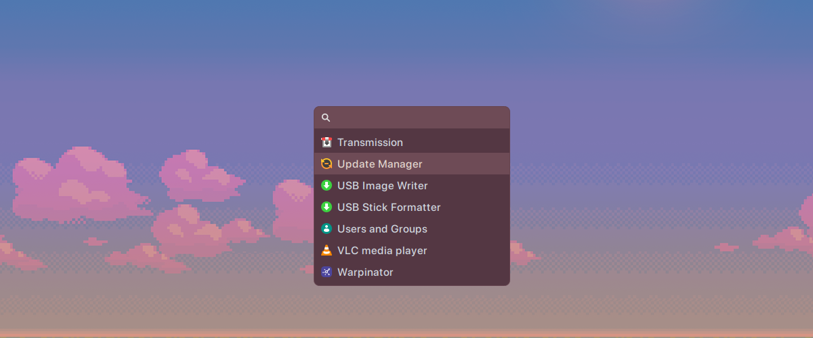
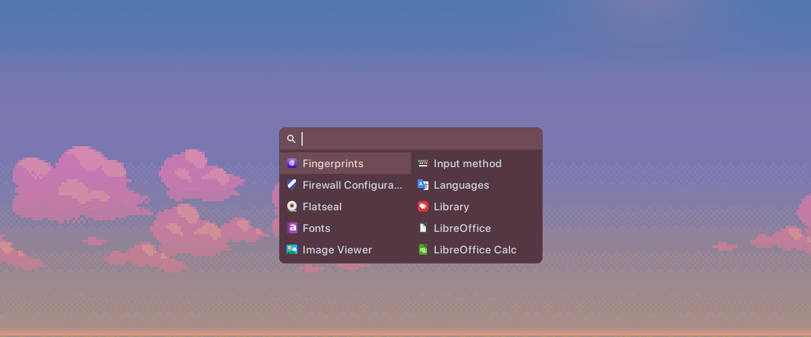
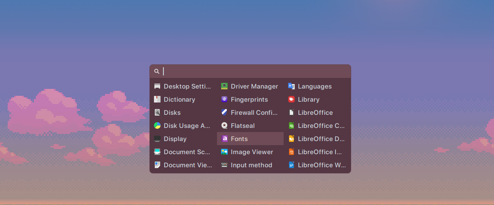
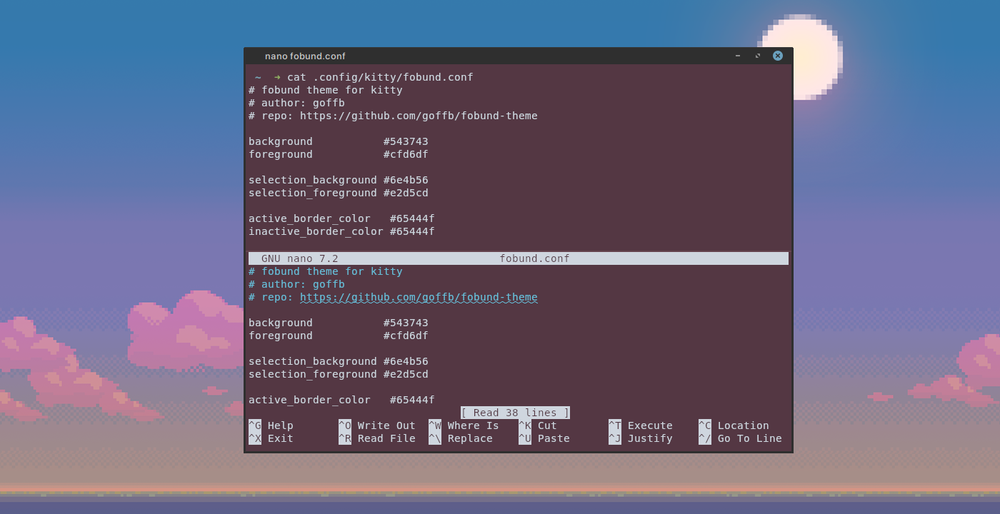
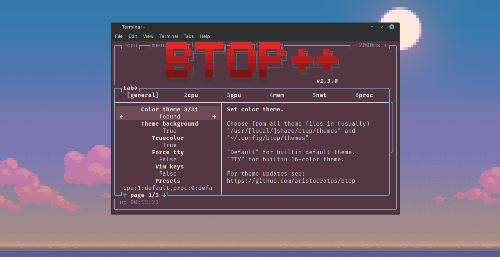
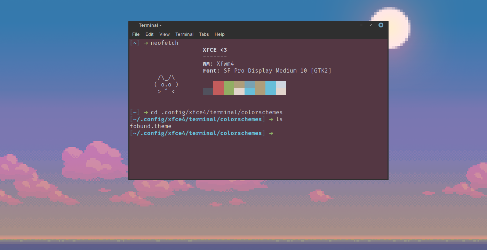

<div align="center">
  <picture>
    <source media="(prefers-color-scheme: dark)" srcset="assets/logo-ts-w.png">
    <source media="(prefers-color-scheme: light)" srcset="assets/logo-ts-b.png">
    
  </picture>
  
  *a theme for linux. available for rofi, kitty, btop, and xfce4-terminal* 

  <p align="center">
    <a href="LICENSE" target="_blank"></a>&nbsp;&nbsp;
  </p>

</div>

## preview

### [rofi](rofi/)

<p align="center">
  
  
  
</p>

### [kitty](kitty/)

<p align="center">
  
</p>

### [btop](btop/)

<p align="center">
  
</p>

### [xfce4-terminal](xfce4-terminal/)

<p align="center">
  
</p>

## palette

| token | color | role |
|---|---|---|
| `--bg` | `#543743` | main background |
| `--surface` | `#6e4b56` | panels and raised surfaces |
| `--surface-alt` | `#51515d` | secondary surface |
| `--field` | `#65444f` | input and editable areas |
| `--border` | `#65444f` | borders and separators |
| `--fg` | `#cfd6df` | primary text |
| `--fg-muted` | `#8c98a6` | muted and secondary text |
| `--fg-warm` | `#e2d5cd` | warm highlight text |
| `--accent` | `#78a2b3` | focus and interactive accents |
| `--accent-hover` | `#67bed9` | active and hover accents |
| `--warm` | `#ae9e7a` | warm accent |
| `--success` | `#92ae64` | success states |
| `--urgent` | `#c25c5c` | urgent and error states |

### use as css variables

```css
:root {
    --bg:            #543743;
    --surface:       #6e4b56;
    --surface-alt:   #51515d;
    --field:         #65444f;
    --border:        #65444f;

    --fg:            #cfd6df;
    --fg-muted:      #8c98a6;
    --fg-warm:       #e2d5cd;

    --accent:        #78a2b3;
    --accent-hover:  #67bed9;
    --warm:          #ae9e7a;

    --success:       #92ae64;
    --urgent:        #c25c5c;
}
```

## install

see the application directories for theme files and installation instructions.

- [rofi](rofi/)
- [kitty](kitty/)
- [btop](btop/)
- [xfce4-terminal](xfce4-terminal/)

